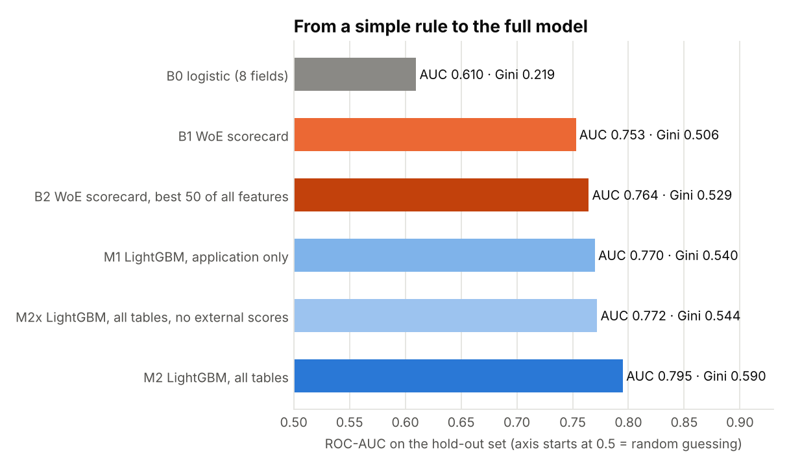
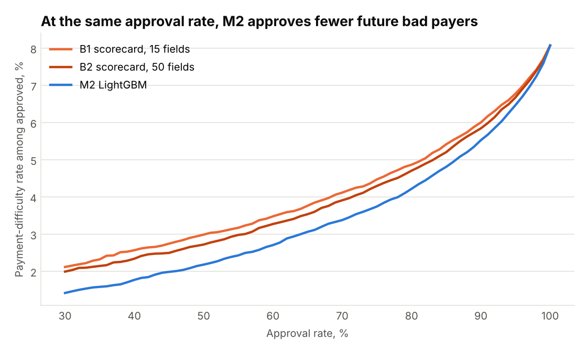

# Installment Credit Risk Scoring 💳

An explainable probability-of-default (PD) model for consumer and point-of-sale installment loans. It comes with a decision layer that applies the Central Bank of Azerbaijan's debt-to-income limit and offers a smaller loan instead of a plain "no". The model and its claims were checked by an [independent validation review](reports/VALIDATION.md), and the findings were fixed.
Portfolio project · November 2026

> A customer asks for an installment loan. In about 0.1 s the system returns:
> - a calibrated **PD** and a risk grade (A–E);
> - the **debt-to-income ratio**, checked against the CBA's 70% limit;
> - a decision: **approve / review / decline**;
> - the main reasons, in English and Azerbaijani;
> - if the request does not fit, **smaller amounts** that the model approves.

## Why this problem

Consumer credit is where Azerbaijani banks' risk is growing:
- Non-performing consumer loans reached **AZN 363m (3.7%)** in H1 2026, up from 2.92% at the end of 2024.
- Consumer loans were **92% of write-offs**.
- **37%** of the consumer book belongs to borrowers whose debt service exceeds 45% of their income.

The rules are tightening at the same time:
- Consumer loans may only go to borrowers with **DTI ≤ 70%**.
- **Decision 39/3 (Sep 2026)** bans behaviour-model income estimates wherever income can be documented.
- Banks must reconcile retailers' installment portfolios with the credit bureau.

Lenders and installment retailers therefore need models that are accurate, calibrated and explainable, and that respect these rules.

Sources:
- [CBA Financial Stability Report H1 2025](https://uploads.cbar.az/assets/FSR%20H1%202025%20ENG.pdf)
- [Trend.az on H1 2026 consumer credit (Oct 2026)](https://www.trend.az/business/4234370.html)
- [CBA regulation on credit risks, para 4.6 (DTI ≤ 70%)](https://uploads.cbar.az/assets/Regulations%20on%20governing%20credit%20risks%20on%20a%20single%20borrower%20or%20a%20group%20of%20related%20borrowers.pdf)
- [Trend.az on Decision 39/3 (Sep 2026)](https://www.trend.az/business/4233655.html)

## Results

**Data:** [Home Credit Default Risk](https://www.kaggle.com/c/home-credit-default-risk) (Kaggle).
- 307,511 applicants in 7 tables: application, credit bureau, bureau monthly balances, previous applications (44% of them point-of-sale "Consumer loans"), installment payments, POS/cash balances and credit cards.
- **Target:** Home Credit's *payment difficulties* flag, 8.07% of applicants. It marks early late payments; it is not a 90-day default.
- **Split:** 80% for development with 5-fold CV. A **20% hold-out of 61,502 applicants** is never used for training, tuning, calibration or cut-offs.

| Model (hold-out) | AUC | Gini |
|---|---|---|
| B0 · logistic regression, 8 application fields | 0.610 | 0.219 |
| B1 · classic **WoE scorecard**, 15 hand-picked fields | 0.753 | 0.506 |
| B2 · **WoE scorecard, best 50 of all features** (same data as M2) | 0.764 | 0.529 |
| M1 · LightGBM, application only | 0.770 | 0.540 |
| M2x · LightGBM, all tables, **without the external scores** | 0.772 | 0.544 |
| **M2 · LightGBM, all 7 tables** (308 features) | **0.795** | **0.590** |

M2's hold-out AUC has a 95% confidence interval of 0.788–0.801. Its gain over B1 is +0.042 AUC (CI 0.038–0.046).



**Business effect at the same 80% approval rate (hold-out):**

| Compared with | Bad rate | M2 approves fewer bad payers by | Loss proxy* |
|---|---|---|---|
| B1, 15-field scorecard | 4.87% → 4.22% | **13.3%** (CI 11–15%) | −16.6% |
| B2, 50-field scorecard | 4.71% → 4.22% | **10.4%** | −15.3% |

Read the other way, at B2's bad rate M2 can approve **4 percentage points more customers**.

*Loss proxy = original amount of approved loans with payment difficulties × an assumed LGD. It points in the right direction but is not a loss forecast.



**The full decision policy on the hold-out set** combines the PD cut-offs with the 70% DTI decline and a 45% review threshold:

| Decision | Share of applicants | Bad rate |
|---|---|---|
| Approve | 61.6% | 3.4% |
| Review | 22.5% | 9.6% |
| Decline | 15.9% | 24.2% |

**Calibration.** In every grade, predicted PD is within about 0.8 points of the observed rate. For example, grade B is predicted at 3.6% and observed at 3.5%; grade E is 22.9% vs 23.3%.

Full report, with the fairness check and score drivers: [reports/REPORT.md](reports/REPORT.md).

## How it works

```
 7 tables ──► features (308) ──► LightGBM ──► isotonic calibration (floor 0.05%) ──► PD ──┐
                                         └──► TreeSHAP ──► reasons (EN/AZ, customer-safe) ┤
 requested amount, term, documented income ──► debt-to-income ratio ─────────────────────┼──► decision layer
                                                                                          │    · DTI > 70% → decline (CBA)
                                                                                          │    · PD cut-offs, 45% review
                                                                                          │    · counter-offers, re-scored
```

| Module | What it does |
|---|---|
| `crs/features.py` | Builds application features and aggregates of the 6 history tables:<br>• late and partial payments, overall and over the last 12 months<br>• refused applications and past POS loans<br>• bureau debt and overdue loans<br>• card utilisation<br>• estimated payments on open loans<br>Some fields are **excluded by policy**: gender, contacts' defaults, building statistics, who accompanied the applicant, and the day/hour of the application |
| `crs/models.py` | The model ladder on the same folds. B1/B2 use `optbinning` with PDO scaling. LightGBM early-stops on a slice of each training fold |
| `crs/calibration.py` | Isotonic calibration on out-of-fold scores, with a Basel III retail PD floor of 0.05% |
| `crs/explain.py` | TreeSHAP reasons grouped into families. Only credit-behaviour and loan reasons are shown to customers; age, family and region appear only in an internal analyst view |
| `crs/policy.py` | The decision rules:<br>• CBA DTI limit of 70%<br>• 45% high-burden review threshold (a lender policy choice)<br>• PD cut-offs and A–E grades<br>• **missing or invalid inputs fail closed** (sent to review, never auto-approved) |
| `crs/scorer.py` | Scores one application, re-scores every counter-offer, and flags category values not seen in training |
| `api/main.py` | FastAPI with `/score`, `/applicants` and `/health`, plus input validation |
| `app/app.py` | Streamlit demo: decision, reasons, counter-offers, portfolio impact and model report |
| `train.py` | One command that takes the raw tables to artifacts, charts, the report and a Kaggle submission file |

**Design choices a risk team will ask about**
- **Income is never estimated.** Only declared or documented income is used, in line with Decision 39/3. Payment behaviour enters only as risk features.
- **The regulation is code, not something learned.** The 70% limit sits in a rule engine, so it is applied exactly and can be explained.
- **The benchmark is fair.** B2 uses the same features as M2, so the M2-vs-B2 gap is the gain from the method alone.
- **Validated independently.** [VALIDATION.md](reports/VALIDATION.md) lists 23 findings (2 critical, 8 high) and how each was handled.

## Getting started

```powershell
python -m venv .venv
.venv\Scripts\activate                       # Mac/Linux: source .venv/bin/activate
pip install -r requirements.txt
python -m pytest -q                          # 14 tests, incl. the full pipeline and API on synthetic data
python -m streamlit run app/app.py           # demo on the committed model (artifacts/)
uvicorn api.main:app --reload                # API docs at http://127.0.0.1:8000/docs
```

**Retrain from the raw data:**
1. Download `home-credit-default-risk.zip` from Kaggle. This needs an account and acceptance of the competition rules.
2. Put the zip in the project folder.
3. Run:

```powershell
python -m crs.data                           # unzip + parquet cache (~1 min)
python train.py                              # ~17 min on 2 cores: artifacts/, reports/, reports/submission.csv
```

`python train.py --synthetic` runs the same pipeline on generated data in about 20 s.

**Docker:** `docker build -t crs . && docker run -p 8000:8000 crs` runs the API. The Dockerfile shows how to run the demo.

## Limitations

- **Not Azerbaijani data.** The method, pipeline and decision layer transfer to a lender's own data; the numbers must be re-measured there. The next step is a 4–6 week pilot on an anonymised portfolio, side by side with the lender's current scorecard.
- **Early-delinquency target.** The target is Home Credit's flag, not a 90-day default, so PDs would be re-calibrated to the lender's default definition.
- **The external scores matter.** The largest driver is Home Credit's anonymous external scores. Without them, AUC is 0.772. A local bureau score would take their place.
- **No out-of-time test.** The data has no dates, so the split is random. Performance on future applicants is usually lower.
- **No reject inference.** Outcomes exist only for loans that were granted.
- **The DTI is a stand-in.** The income period is not stated, and payments on open bureau loans are estimated. A lender would use contractual instalments from the credit registry.
- **Proxies for protected attributes remain.** Gender is excluded, yet the inputs still predict it (AUC 0.90). Approval for under-25s is 0.67 of the rate for over-50s. Both are findings for a compliance review.

## Structure

```
crs/        data.py, features.py, models.py, calibration.py, explain.py, policy.py, business.py, scorer.py, report.py, synthetic.py
api/        main.py (FastAPI)
app/        app.py (Streamlit)
artifacts/  m2.txt (LightGBM), calibrator.json, b1_scorecard.pkl, meta.json, profiles.parquet (300 hold-out applicants), holdout_scores.parquet
reports/    REPORT.md, VALIDATION.md, results.json, charts, submission.csv
tests/      test_pipeline.py
train.py
```
