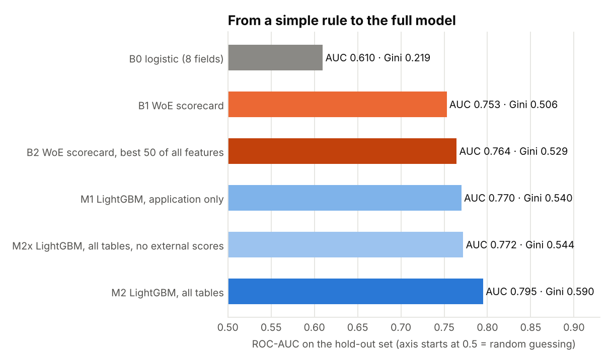
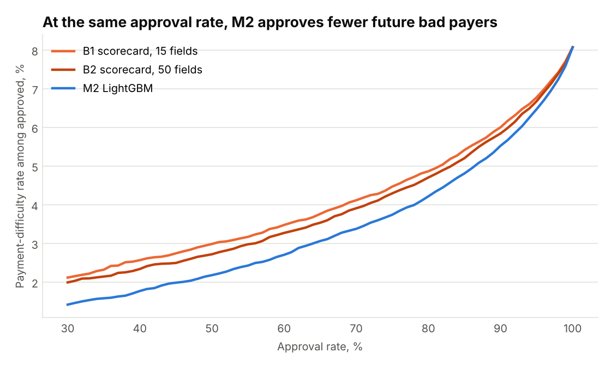
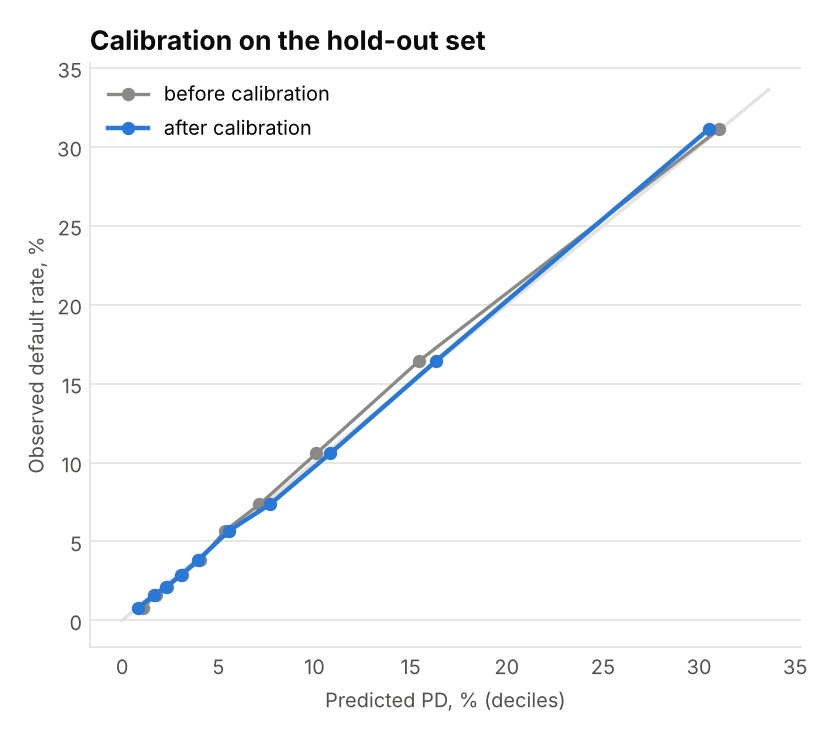
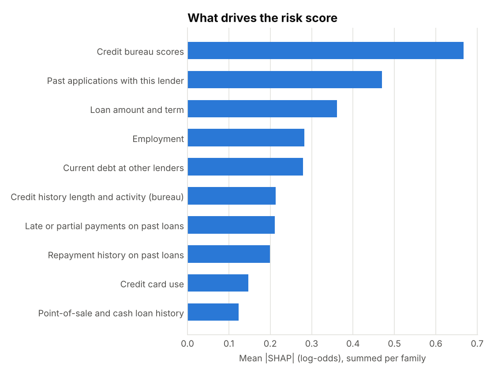

# Evaluation report

Data: home-credit-default-risk · development 246,009 applicants (5-fold CV) · hold-out 61,502 applicants (never used for training, tuning, calibration or cut-offs) · 308 features in M2.

**Target.** Home Credit's `TARGET` = the client had *payment difficulties* (late more than X days on at least one of the first Y instalments). It is an early-delinquency flag, not a 90+ days-past-due or IFRS 9 default. Rate in the data: 8.1%. "PD" below means the probability of this event; a lender would re-calibrate to its own default definition.

## Model ladder (hold-out)

| Model | AUC | Gini | KS | PR-AUC | CV AUC (dev) |
|---|---|---|---|---|---|
| B0 logistic (8 fields) | 0.6097 | 0.2195 | 0.1688 | 0.1151 | 0.6083 |
| B1 WoE scorecard | 0.7529 | 0.5059 | 0.3794 | 0.2356 | 0.7483 |
| B2 WoE scorecard, best 50 of all features | 0.7644 | 0.5287 | 0.3982 | 0.2516 | 0.7598 |
| M1 LightGBM, application only | 0.7699 | 0.5399 | 0.4014 | 0.2561 | 0.7642 |
| M2x LightGBM, all tables, no external scores | 0.7720 | 0.5440 | 0.4115 | 0.2554 | 0.7648 |
| M2 LightGBM, all tables | 0.7950 | 0.5900 | 0.4443 | 0.2929 | 0.7885 |

- M2 vs the compact 15-field scorecard B1: **Gini 0.506 → 0.590**.
- M2 vs the 50-field scorecard B2 built from the **same features**: **Gini 0.529 → 0.590**. This is the fair "same data, better method" gain.
- Without Home Credit's anonymous external scores (`EXT_SOURCE_1-3`), which an Azerbaijani lender would replace with its own bureau score, M2x reaches AUC 0.772.

## Business effect (hold-out)

Applicants are approved in order of score; each model approves the same share.

**M2 vs the compact scorecard B1**

| Approval rate | Bad rate, B1 | Bad rate, M2 | Change | Loss-proxy change* | Extra approvals at the same bad rate |
|---|---|---|---|---|---|
| 50% | 2.99% | 2.18% | -27.0% | -31.5% | +13.6 pp |
| 55% | 3.17% | 2.43% | -23.4% | -26.1% | +11.8 pp |
| 60% | 3.48% | 2.71% | -22.2% | -25.4% | +11.3 pp |
| 65% | 3.76% | 3.06% | -18.6% | -22.9% | +10.2 pp |
| 70% | 4.12% | 3.38% | -17.9% | -21.1% | +9.2 pp |
| 75% | 4.47% | 3.74% | -16.3% | -19.2% | +7.2 pp |
| 80% | 4.87% | 4.22% | -13.3% | -16.6% | +5.5 pp |
| 85% | 5.42% | 4.81% | -11.2% | -14.3% | +4.4 pp |
| 90% | 6.00% | 5.53% | -7.9% | -10.8% | +2.8 pp |
| 95% | 6.78% | 6.47% | -4.5% | -6.8% | +1.3 pp |

**M2 vs the 50-field scorecard B2**

| Approval rate | Bad rate, B2 | Bad rate, M2 | Change | Loss-proxy change* | Extra approvals at the same bad rate |
|---|---|---|---|---|---|
| 50% | 2.72% | 2.18% | -19.8% | -28.3% | +10.3 pp |
| 55% | 2.98% | 2.43% | -18.5% | -24.7% | +8.5 pp |
| 60% | 3.27% | 2.71% | -17.3% | -24.0% | +7.9 pp |
| 65% | 3.54% | 3.06% | -13.4% | -20.7% | +7.0 pp |
| 70% | 3.91% | 3.38% | -13.6% | -20.2% | +6.7 pp |
| 75% | 4.30% | 3.74% | -12.9% | -18.4% | +5.6 pp |
| 80% | 4.71% | 4.22% | -10.4% | -15.3% | +4.0 pp |
| 85% | 5.21% | 4.81% | -7.6% | -11.5% | +3.0 pp |
| 90% | 5.84% | 5.53% | -5.4% | -8.7% | +2.0 pp |
| 95% | 6.68% | 6.47% | -3.1% | -5.9% | +0.9 pp |

At 80% approval, M2 approves 13% fewer bad payers than B1 and 10% fewer than B2.

*Loss proxy = original loan amount of approved applicants with payment difficulties × an assumed LGD. It ignores amortisation, cures and recoveries and uses an early-delinquency flag, so treat it as a direction, not a loss forecast. The percentage change does not depend on the LGD value.

## Head-to-head: where the models disagree (hold-out, 80% approval)

Both the 50-feature WoE scorecard (B2) and M2 approve the lowest-risk 80% of the 61,502 hold-out applicants. They agree on 90.2% of them.

| Group | Applicants | Bad rate | Bad payers |
|---|---|---|---|
| Both approve | 46,199 | 3.90% | 1,804 |
| Both decline | 9,299 | 25.56% | 2,377 |
| Only B2 approves (M2 declines) | 3,002 | 17.06% | 512 |
| Only M2 approves (B2 declines) | 3,002 | 9.06% | 272 |

Swapping the 3,002 disagreements removes 240 bad payers at the same approval volume (4.71% → 4.22% approved bad rate, -10.4%). The riskiest 10% by M2 holds 38.4% of all bad payers, against 34.8% for B2. Reproduce with `scripts_extra/b2_holdout.py` (rebuilds the B2 hold-out scores with the same split).

## The full decision policy (hold-out)

Cut-offs from development scores only: approve PD ≤ 8.97%, decline PD > 15.51%, review in between; plus the CBA 70% DTI decline and the 45% high-burden review threshold, applied exactly as the scorer applies them.

| Decision | Applicants | Share | Bad rate |
|---|---|---|---|
| APPROVE | 37,890 | 61.6% | 3.37% |
| CONDITIONAL | 13,859 | 22.5% | 9.60% |
| DECLINE | 9,753 | 15.9% | 24.19% |

Debt-service ratio (new payment + estimated payments on open bureau loans) / declared income:

| DTI band | Applicants | Bad rate |
|---|---|---|
| <=45% | 53,088 | 7.79% |
| 45-70% | 6,315 | 9.44% |
| >70% | 2,097 | 11.25% |

The DTI here is a stand-in: Home Credit does not state the income period, and payments on open bureau loans are estimated (reported annuity; else 5% of a card balance; else debt over the remaining term, at least 12 months). A lender would use contractual instalments from the credit registry. The rule engine itself is exact; its inputs here are approximate.

## Calibration (hold-out)

| Grade | Applicants | Predicted PD | Observed bad rate |
|---|---|---|---|
| A | 18,279 | 1.49% | 1.39% |
| B | 13,798 | 3.58% | 3.49% |
| C | 9,413 | 6.29% | 6.47% |
| D | 7,419 | 10.08% | 9.30% |
| E | 12,593 | 22.87% | 23.27% |

Brier 0.0653, ECE 0.0023. An ECE this small is within the sampling noise of a perfectly calibrated model, so the grade table is the better evidence. Isotonic calibration fitted on out-of-fold scores; PD floored at 0.05% (Basel III retail floor) and capped at 95%.

## Stability

PSI development vs hold-out 0.0002; vs Kaggle's unlabeled applicants 0.0089. Both samples come from the same period, so a low PSI is expected and is **not** evidence of stability over time. The data has no dates: out-of-time stability cannot be tested and belongs in a pilot.

## Fairness and excluded fields

Excluded from the model by policy: gender, defaults among the applicant's contacts (`*_SOCIAL_CIRCLE`), statistics of the applicant's building (`*_AVG/_MODE/_MEDI`), who accompanied the applicant, and the day and hour of the application. Age, family status, region and education stay in the model but are never given to the customer as reasons.

Excluding gender does not remove it: the model's inputs predict gender with AUC 0.90.

| Group | Applicants | Approval at 80% policy | Bad rate |
|---|---|---|---|
| gender: F | 40,296 | 82.7% | 7.03% |
| gender: M | 21,206 | 74.8% | 10.05% |
| age: <25 | 2,442 | 59.5% | 13.23% |
| age: 25-35 | 14,547 | 70.3% | 10.59% |
| age: 35-50 | 23,805 | 80.4% | 7.99% |
| age: 50+ | 20,708 | 88.7% | 5.79% |

Approval ratio under-25 vs 50+: **0.67** (the "four-fifths" screening rule flags values below 0.80). The gaps track observed bad rates, but this is a finding for a compliance review, not a clean bill of health.

## What drives the score

## Limitations

- Home Credit's public Kaggle data (2018), not Azerbaijani data. Method, pipeline and decision layer transfer; every number must be re-measured on a lender's own data.
- No application dates: random split, no out-of-time test; real performance on future applicants is usually lower.
- No reject inference: outcomes exist only for loans that were granted.
- The target is early payment difficulty, not default; the loss figures are a proxy.
- Independent validation findings and how they were addressed: [VALIDATION.md](VALIDATION.md).
